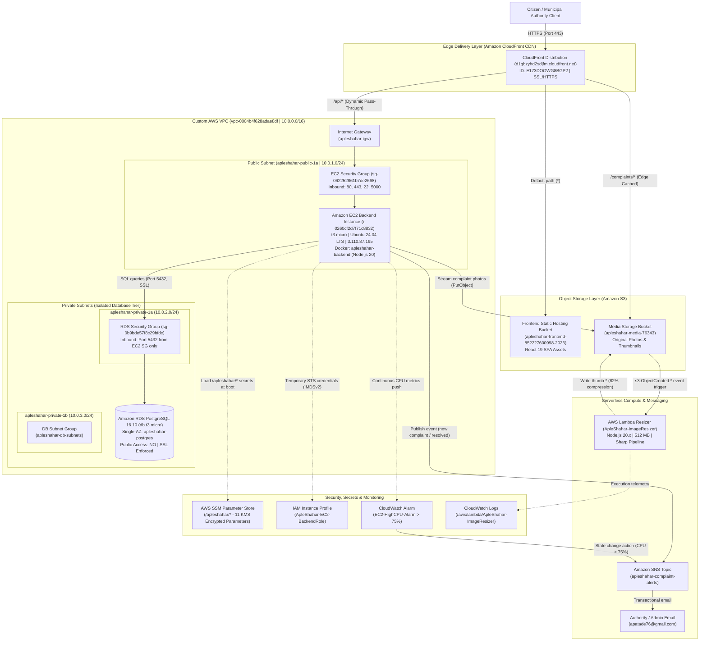

# ApleShahar Live AWS Architecture Diagram & Specification

This document details the final production-ready AWS cloud architecture implemented for the **ApleShahar** civic grievance and municipal facility management platform in region `ap-south-1` (Mumbai).

---

## 1. High-Level Architecture Diagram

---

## 2. Architectural Subsystem Breakdown

### 1. Edge & Content Delivery (Amazon CloudFront)
- **Role**: Serves as the single unified entry point for all client web traffic, API calls, and media requests.
- **Origins**:
  1. `S3-Website-Origin`: S3 static hosting bucket for the compiled React Single Page Application (SPA).
  2. `EC2-Backend-Origin`: Amazon EC2 instance (`ec2-3-110-87-195.ap-south-1.compute.amazonaws.com:5000`).
  3. `S3-Media-Origin`: S3 media bucket (`apleshahar-media-76343`).
- **Behaviors**:
  - `/*` -> S3 Frontend bundle with custom error responses (403 and 404 return `/index.html` with status 200).
  - `/api/*` -> Forwarded dynamically to EC2 (caching disabled, all HTTP methods allowed, headers forwarded).
  - `/complaints/*` -> S3 media bucket with edge caching enabled (`DefaultTTL = 86400`).

### 2. Network Tiering & Isolation (Amazon VPC)
- **VPC CIDR**: `10.0.0.0/16` in region `ap-south-1` (Mumbai).
- **Public Subnet**: `apleshahar-public-1a` (`10.0.1.0/24`) with Internet Gateway route (`0.0.0.0/0`). Hosts the EC2 compute instance.
- **Private Subnets**: `apleshahar-private-1a` (`10.0.2.0/24`) and `apleshahar-private-1b` (`10.0.3.0/24`) across Availability Zones `ap-south-1a` and `ap-south-1b`. Local routing only (`10.0.0.0/16`).
- **Security Group Chaining**: `apleshahar-rds-sg` restricts port 5432 exclusively to traffic originating from `apleshahar-ec2-sg`. The database is physically unreachable from the public internet.

### 3. Core Compute (Amazon EC2)
- **Instance**: `apleshahar-backend-server` (`i-0260cf2d7f71c8832`, `t3.micro`, Ubuntu 24.04 LTS).
- **Runtime**: Docker Compose managing container `apleshahar-backend` running Node.js 20 and Express REST API on port 5000.
- **Credentials**: Zero hardcoded access keys. The AWS SDK automatically retrieves temporary credentials via IAM Instance Profile `ApleShahar-EC2-BackendRole` (IMDSv2).

### 4. Relational Database Layer (Amazon RDS PostgreSQL)
- **Database**: `apleshahar-postgres` (PostgreSQL 16.10, `db.t3.micro`, 20 GB gp3).
- **Subnet Group**: `apleshahar-db-subnets` spanning both private subnets.
- **Features**: Connection pooling via `pg.Pool`, enforced SSL encryption, and automated schema initialization (`initDb()` and `npm run db:init`).

### 5. Serverless Media Pipeline (AWS Lambda & Amazon S3)
- **Bucket**: `apleshahar-media-76343`.
- **Lambda Resizer**: `ApleShahar-ImageResizer` (Node.js 20.x, 512 MB).
- **Workflow**: Citizen photo upload triggers `s3:ObjectCreated:*` event -> Lambda resizes image -> writes `thumb-*` back to S3 (~82% payload size reduction) -> prevents CPU saturation on EC2.

### 6. Decoupled Pub/Sub Messaging (Amazon SNS)
- **Topic**: `apleshahar-complaint-alerts`.
- **Triggers**:
  1. Application trigger: Express backend publishes complaint filing and resolution events.
  2. Infrastructure trigger: CloudWatch alarm `EC2-HighCPU-Alarm` publishes breach notifications if EC2 CPU > 75% for 5 minutes.
- **Subscriber**: `apatade76@gmail.com`.

### 7. Secrets Management (AWS Systems Manager Parameter Store)
- **Parameters**: 11 managed parameters under `/apleshahar/*`.
- **Security**: Database passwords and JWT secrets encrypted as `SecureString` using AWS KMS.
- **Loading**: Injected asynchronously into process memory at application boot; zero plaintext secrets on server disk.
