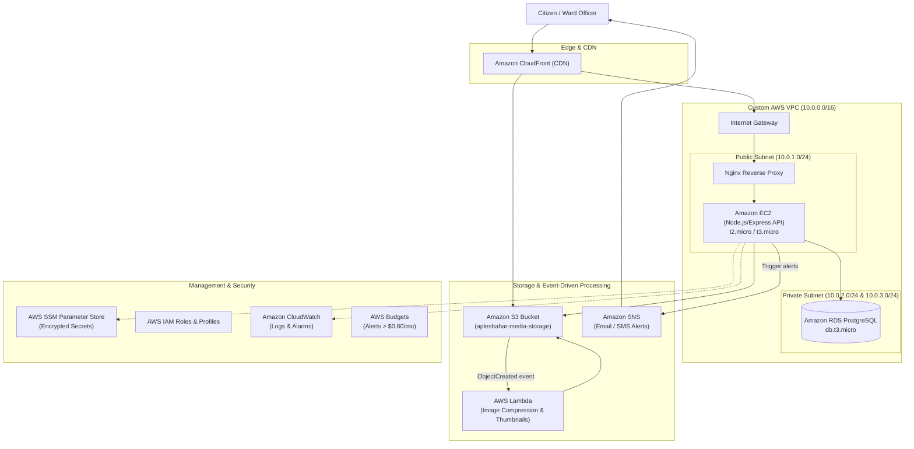

# ApleShahar AWS Cloud Architecture Migration Plan

This document details the target cloud architecture and migration strategy for **ApleShahar**, moving from third-party BaaS (Supabase) to a self-managed, resilient, and cost-optimized AWS infrastructure.

Reference image: [`aws_mig_plan/image.png`](file:///C:/Users/arnav/Desktop/cclmp/aws_mig_plan/image.png)

---

## 📋 Architecture & Service Matrix

| Cloud Area / Requirement | AWS Cloud Service / Technology | Functional Role in ApleShahar |
| :--- | :--- | :--- |
| **Compute** *(Mandatory Non-Serverless)* | **Amazon EC2** (`t2.micro` / `t3.micro` Linux) | Hosts containerized Node.js/Express backend REST API and Nginx reverse proxy / web server. |
| **Networking** *(Mandatory VPC)* | **Custom AWS VPC** (`10.0.0.0/16`) | Network isolation with Public Subnet (`10.0.1.0/24`), Private Subnets (`10.0.2.0/24`, `10.0.3.0/24`), Internet Gateway (IGW), Route Tables & Security Groups. |
| **Database** *(Mandatory Managed DB)* | **Amazon RDS PostgreSQL** (`db.t3.micro`) | Managed relational database for users, complaints, ward metrics, and timelines, placed securely in private subnets. |
| **Storage** *(Mandatory S3)* | **Amazon S3** (`apleshahar-media-storage`) | Bucket for citizen complaint photos, officer resolution proof images, and generated PDF reports. |
| **Security & Access Control** | **AWS IAM** (Roles & Instance Profile) | Least-privilege IAM role attached to EC2 to access S3 & SSM without hardcoding credentials in code. |
| **Secrets Management** | **AWS Systems Manager (SSM) Parameter Store** | Stores encrypted database credentials (`SecureString`) and JWT secret keys. |
| **Monitoring & Logging** | **Amazon CloudWatch** (Logs, Metrics & Alarm) | Collects EC2/Nginx logs, tracks CPU/memory metrics, and triggers alarms on threshold breach (e.g. CPU > 75%). |
| **Cost Management** | **AWS Budgets** | Automated budget tracking that sends email alerts if forecasted monthly spend exceeds $0.80 USD. |
| **Supporting Serverless** *(Capability 1)* | **AWS Lambda** (Node.js 20.x runtime) | Event-driven function triggered by S3 uploads to validate, compress, and create thumbnails of complaint photos. |
| **Decoupled Messaging** *(Capability 2)* | **Amazon SNS** (Simple Notification Service) | Dispatches instant email/SMS notifications to ward officers on new issues and to citizens when complaints are resolved. |
| **Content Delivery** *(Capability 3)* | **Amazon CloudFront** | Edge caching for static frontend files and S3 complaint images to ensure low latency. |

---

## 🏛️ Target Cloud Architecture

---

## 🔧 Subsystem Implementation Breakdown

### 1. Networking & Isolation
- **VPC CIDR**: `10.0.0.0/16`
- **Public Subnet (`10.0.1.0/24`)**: Hosts the EC2 instance running Nginx (ports 80/443 open to Internet via Security Group).
- **Private Subnets (`10.0.2.0/24`, `10.0.3.0/24`)**: Spans two Availability Zones to meet RDS PostgreSQL Multi-AZ subnet group requirements; inbound port 5432 allowed only from the EC2 Security Group.

### 2. Compute & API Layer
- **Containerized Node.js/Express**: Runs inside Docker on Amazon Linux 2023 / Ubuntu.
- **Nginx**: Handles SSL termination (Certbot / Let's Encrypt), static file serving or reverse-proxying requests to `localhost:5000`.

### 3. Database Layer
- **RDS PostgreSQL (`db.t3.micro`)**: Replaces Supabase Database while maintaining standard PostgreSQL schema for `users`, `complaints`, and `facility_requests`.
- **Connection Security**: Enforced SSL mode (`ssl: { rejectUnauthorized: false }` or with AWS RDS CA certificate).

### 4. Storage & Serverless Media Pipeline
- **S3 Bucket (`apleshahar-media-storage`)**: Replaces Supabase Storage bucket (`apleshahar`).
- **Lambda Processor**: Triggered on `s3:ObjectCreated:*` to resize high-resolution user photos to web-optimized formats, saving bandwidth and storage costs.

### 5. Notifications & Messaging
- **Amazon SNS**: Replaces manual status polling by pushing transactional messages:
  - Notifies assigned ward officers when a new complaint is filed in their ward.
  - Alerts citizens when an authority marks an issue `resolved` or updates ETA.

### 6. Secrets, Security & Budget Control
- **SSM Parameter Store**: Replaces `.env` secrets on EC2 (`/apleshahar/db_password`, `/apleshahar/jwt_secret`, `/apleshahar/authority_code`).
- **AWS Budgets**: Prevents accidental cost spikes with a threshold alert set at $0.80 USD.
